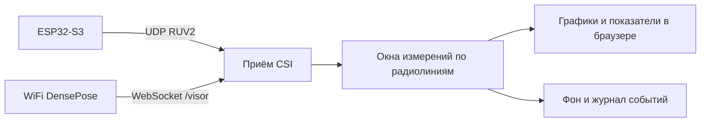

# Техническое руководство Радиодозора

[Обработка CSI](#обработка-csi) · [Режимы наблюдения](#режимы-наблюдения) · [Параметры запуска](#параметры-запуска) · [Проверка стенда](#проверка-стенда) · [ESP32-C5](#сравнение-с-esp32-c5)

## Обработка CSI



UDP-приёмник ожидает заголовок RUV2 и 64 пары знаковых 8-битных значений I/Q. Радиолиния определяется приёмником, источником, Wi-Fi-каналом и признаком межплатного кадра. В режиме `/visor` сервер запрашивает `visor_snapshot` и разбирает свежие кадры из ответов `visor_csi`.

Обработка выбирает 52 поднесущие, нормирует амплитуды на среднее по кадру и усредняет данные в интервалах по 100 мс. Окна с недостаточным числом отсчётов отбрасываются. Для движения используется разброс амплитуд примерно за 1,5 секунды, для оценки ритма — спектр примерно за 40 секунд. Потеря CSI отображается отдельно от спокойного сигнала.

## Режимы наблюдения

### Охрана помещения

1. Запишите пустую комнату и выберите радиолинию. В обзоре ΔI/ΔQ показано изменение нормированного комплексного сигнала после компенсации общего поворота фазы. Кольца служат шкалой, а след исчезает за 2,5 секунды.
2. Значение движения **1×** и выше означает достижение порога фона. Для дыхательного ритма нужен устойчивый пик в диапазоне **6–30 циклов в минуту**. Оценка возобновляется после накопления спокойного сигнала. График строится по поднесущей с самым выраженным пиком.
3. Нажмите **«Включить тревогу»**. Для срабатывания нужны два последовательных измерения движения или три оценки ритма на одной линии. Уведомление остаётся до сброса или выключения тревоги. Звук можно включить в открытой вкладке.

### Опека · сон

1. Выключите тревогу и выберите **«Опека · сон»**. Для начального опыта разместите одну ESP сбоку, примерно на уровне груди, на расстоянии до 1 м. Выберите её радиолинию и сохраните положение роутера и платы.
2. Запишите фон с пустым спальным местом. Для этого режима используется отдельный файл фона. После крупного движения окно спокойного сигнала набирается заново.
3. График показывает сигнал в дыхательном диапазоне. Сила дыхательного сигнала выражена как отношение амплитуды спектрального пика к порогу фона. Кандидат пульса появляется при отдельном устойчивом пике в диапазоне **0,8–2,15 Гц**. Алгоритм сравнивает обе половины окна и исключает частоты вблизи гармоник дыхания.

На оценку влияют повороты тела, ритмические помехи и потери кадров. При недостаточном сигнале интерфейс показывает прочерки. Автоматические тревоги доступны в режиме охраны помещения. Для наблюдения за состоянием спящего используйте проверенный монитор.

## Параметры запуска

| Параметр | Назначение |
| --- | --- |
| `--port 8010` | HTTP-порт панели на `127.0.0.1` |
| `--udp-port 5555` | Порт прямого приёма RUV2 на сетевых интерфейсах ноутбука |
| `--from-visor URL` | Получать CSI от WiFi DensePose по WebSocket |
| `--no-browser` | Запускать сервер без открытия вкладки |
| `--data-dir ПУТЬ` | Каталог фона и событий, по умолчанию `data/` рядом с сервером |

Для ручного запуска из каталога проекта используйте Python 3.11 или новее. Пример для оболочки Linux или macOS.

```bash
python3 -m venv .venv
.venv/bin/python -m pip install -r requirements.txt
.venv/bin/python server.py
```

## Проверка стенда

1. Зафиксируйте положение плат и роутера. Проверьте стабильность потока и запишите фон в пустой комнате.
2. Запишите три серии в одинаковой расстановке. Начните с пустой комнаты, затем запишите спокойное дыхание сидя и ходьбу. При сравнении дыхания дождитесь 40 секунд спокойного сигнала и сверяйте оценку с независимым отсчётом на том же отрезке.
3. Повторите опыт с вентилятором. Отдельно отметьте пропуски CSI, отклонение от контрольной частоты и ложные тревоги. Повторите калибровку и сравнение после смены канала, расположения устройств или комнаты.

Синтетические тесты охватывают разбор кадров, калибровку, обработку разрывов потока, обнаружение движения, тревогу и спектральные кандидаты. Натурный опыт нужен для оценки точности и ложных срабатываний.

## Сравнение с ESP32-C5

Модуль ESP32-C5-WROOM-1-N4 поддерживает Wi-Fi 6 на 2,4 и 5 ГГц и имеет 4 МБ флеш-памяти. Для испытаний потребуется порт прошивки и проверка формата CSI-кадров для выбранного PHY. [Спецификация модуля](https://documentation.espressif.com/esp32-c5-wroom-1_wroom-1u_datasheet_en.html), [форматы CSI ESP32-C5](https://docs.espressif.com/projects/esp-idf/en/latest/esp32c5/api-guides/wifi-driver/wifi-vendor-features.html).

Для сравнения измерьте S3 и C5 на 2,4 ГГц, затем C5 на 5 ГГц в той же расстановке. Для каждой серии запишите отдельный фон. Сопоставьте число полученных кадров, отклонение оценки дыхания от контрольного отсчёта и частоту ложных тревог.
